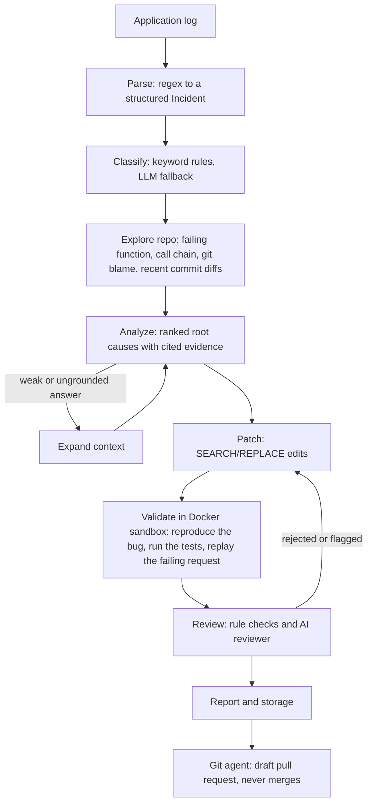

# LogSentinel AI

**An AI incident investigator for production failures: logs in, tested fix proposal out.**

When a service crashes, LogSentinel AI reads the logs, finds the failing code and the recent commits, ranks the probable root causes with evidence, proposes a patch, **tests the patch in an isolated Docker sandbox**, and opens a **draft pull request** for a human to review. It never merges anything.

> Built as a portfolio project. It is a prototype evaluated on a demo app, and the limits are listed honestly below.

## Results

Evaluated on **15 injected failure scenarios** in a FastAPI demo app (fresh run of every incident):

| Metric | Result |
|---|---|
| Correct root cause ranked #1 | **13 / 15** |
| Correct root cause in the top 3 | **14 / 15** |
| Failure category classified correctly | **15 / 15** |
| Patch validated in the sandbox, no review warnings | **12 / 15** |
| Patch passed but flagged for human review | 3 / 15 |
| Time per investigation | about 5 to 9 s unthrottled, median 26 s on a rate-limited free LLM tier |

The three flagged incidents cannot be fixed by editing code: a missing secret, an uninstalled package, and a payment gateway that is down. The system **refuses to fake a fix** and hands them to a human. The full per-incident table is in [`results/EVALUATION.md`](results/EVALUATION.md).

### A lesson from building it
The first version of the sandbox only checked that the failing request stopped returning HTTP 500. It happily "validated" a patch that **deleted the payment-gateway call**, so every payment would be recorded without being charged. I added a review layer (rule-based checks for swallowed errors, removed external calls, no-op stubs and weakened configuration, plus an independent AI reviewer) and a rule that only fully reviewed patches can become pull requests.

## How it works



| Stage | What it does |
|---|---|
| **Parse** | Turns raw logs into a structured incident (error type, failing file, function, line, request, repeat count). Regex first, no LLM needed |
| **Classify** | Labels the failure (Database, Configuration, Timeout...). Rules decide when sure, and an LLM only handles unclear cases |
| **Explore** | Reads the code at the deployed git version: the failing function, constants, call chain, `git blame`, and the diffs of recent commits across all files |
| **Analyze** | Asks the LLM for up to 3 ranked causes as validated JSON. Quoted evidence is checked against the source it was given, and weak or ungrounded answers trigger one retry with more context |
| **Patch** | The LLM proposes exact search-and-replace edits. Our code validates them and generates the diff. Tests and files outside the app are off limits |
| **Validate** | Runs the original and the patched code in a Docker container with **no network**, limited memory and CPU, and a non-root user. The bug must reproduce first, then the tests must pass and the failing request must stop crashing |
| **Review** | Rule checks plus an independent AI reviewer look for patches that hide the error instead of fixing it |
| **Git agent** | Only fully validated patches become pull requests. It opens a **draft**, works in a temporary worktree, and has no merge operation |

### Design decisions
- **Rules before LLMs.** Cheaper, faster, and easy to test and explain.
- **The LLM never writes a diff.** Models get line numbers wrong, so edits are validated against the real file.
- **A patch must be proven, not plausible.** The sandbox reproduces the bug first, so a passing test suite alone is never enough.
- **Fail loudly.** When the cause is outside the code, the system flags it for a human.
- **Human in the loop.** Draft pull requests only, with the full investigation report as the description.

## Quick start

```bash
git clone https://github.com/VISHAL-RAJA-25/logsentinel-ai.git && cd logsentinel-ai
python3 -m venv venv && source venv/bin/activate
pip install -r backend/requirements.txt
git fetch origin "+refs/heads/bug/*:refs/heads/bug/*"     # the 15 bug branches used as scenarios
```

Create a `.env` file in the project root:

```
GROQ_API_KEY=your_key
LLM_MODEL=groq/openai/gpt-oss-20b
GITHUB_TOKEN=optional_only_for_pull_requests
GITHUB_REPO=your-user/your-repo
```

```bash
cd backend
python -m app.services.sandbox build                 # one-time: builds the sandbox image (Docker Desktop must be running)
python -m app.graph.pipeline 004 --patch             # investigate incident 004 end to end
python -m app.graph.pipeline --list                  # stored investigations
python -m app.agents.git_agent <id>                  # dry run of a draft pull request (add --create to open it)
python -m app.evaluation --rerun                     # re-run all 15 incidents and score them
python -m pytest -q                                  # test suite
```

## Project structure

```
backend/app/
  agents/      log_parser, classifier, repo_explorer, root_cause, patch_generator, patch_review, git_agent
  graph/       pipeline (LangGraph), report
  services/    sandbox (Docker), storage (SQLAlchemy)
  models/      Pydantic schemas
  evaluation.py
demo_app/      the FastAPI shop app that is broken on purpose
scenarios/     the 15 bug definitions and the runner that creates their logs
datasets/      15 real incident logs with their answer keys
sandbox/       Dockerfile of the test sandbox
results/       evaluation output
```

**Stack:** Python, FastAPI, LangGraph, LiteLLM (Groq), Pydantic, SQLAlchemy (SQLite), Docker SDK, Git, GitHub REST API, pytest.

## Limitations

- **Development scenarios.** Rules and prompts were tuned while looking at these 15 bugs, so the results are optimistic. Unseen bugs are the real test.
- **Easy setting.** In every scenario the newest commit is the bug. Real incidents are often older, or are not code changes at all.
- **"Validated" is not "correct".** It means the checks above passed. A human must review every patch.
- **LLM-graded diagnosis.** The answer key is compared by an LLM judge (keyword matching as a fallback), so the grader can be wrong.
- **Uncalibrated confidence.** The model's confidence percentages are not meaningful: about 90% whether right or wrong.
- **Scope.** Python and FastAPI only. Patches may only touch the app's source folder. Replaying a failing request needs the request payload, which these demo logs don't contain, so the scenarios store it.
- **Free-tier LLM.** Rate limits dominate latency.

## Roadmap
React dashboard (incident list, report, diff and sandbox verdict), unseen-bug benchmark, PostgreSQL via `docker-compose`, CI on GitHub Actions.